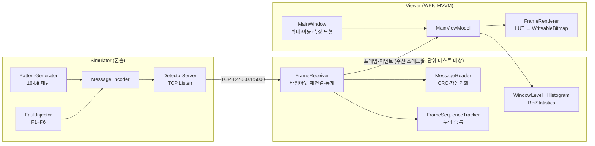
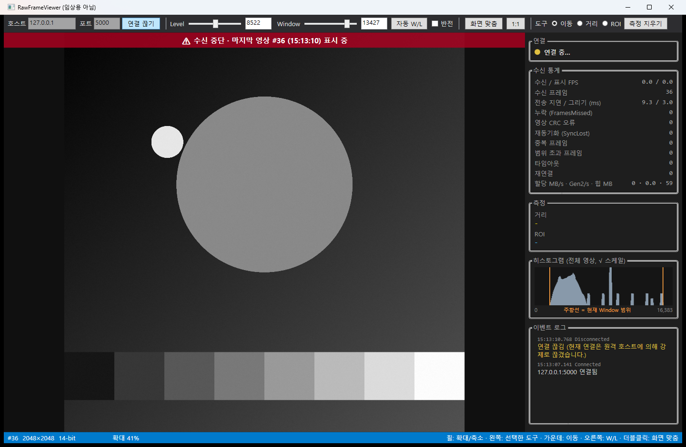
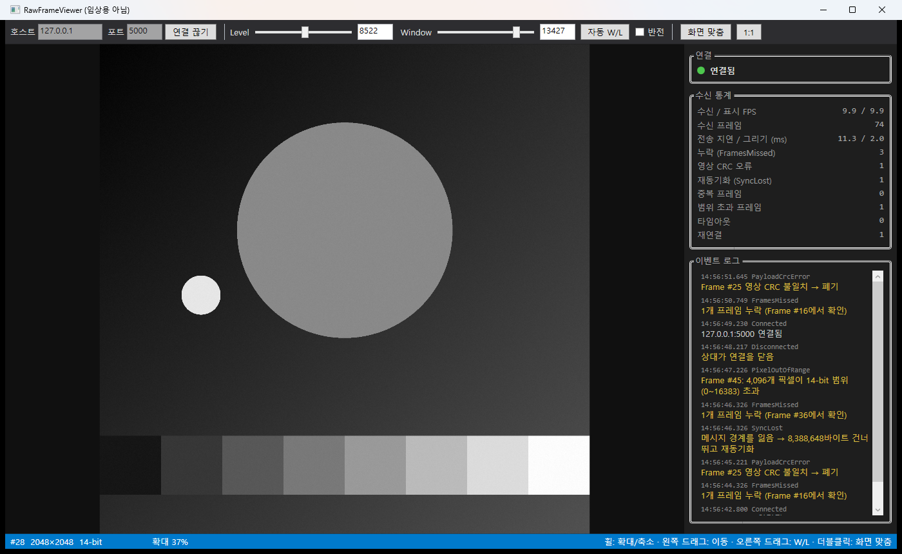

# RawFrameViewer

16-bit 검출기 영상을 TCP로 받아 표시하는 **Windows(WPF) 영상 뷰어**와, 실제 장비 대신 영상을 보내는 **가상 검출기 시뮬레이터**입니다.


> ⚠️ **임상용이 아닙니다.** 영상 뷰어 엔지니어링, 장비 통신, 검증 과정을 보여 주기 위한 개인 포트폴리오입니다. 진단이나 의료 목적으로 사용할 수 없으며, 실제 장비 프로토콜이나 DICOM과는 관계없습니다.

## 이 프로젝트에서 보여 주려는 것

| | 내용 | 근거 |
|---|---|---|
| **명세 먼저** | 전송 프로토콜(헤더 36바이트, Little-endian, CRC-32, 재동기화, 타임아웃)을 문서로 먼저 정하고, 테스트 이름에 명세 조항 번호(§)를 달았습니다. | [protocol.md](docs/protocol.md) |
| **오류를 일부러 일으켜 검증** | 시뮬레이터에서 프레임 누락·영상 손상·헤더 손상·연결 끊기·전송 정지·범위 초과 6가지 오류를 주입하고, 뷰어가 명세대로 감지·복구하는지 확인했습니다. | [오류 주입](#오류-주입) |
| **숫자로 확인** | ROI 통계를 시뮬레이터의 이론값과 비교하고, 성능은 Release 빌드에서 할당 속도·GC까지 측정했습니다. | [ai-log 측정 메모](docs/ai-log.md#측정-메모) |
| **추적 가능성** | 요구사항 → 구현 → 테스트·실행 검증을 표로 연결하고, 검증하지 못한 부분도 적었습니다. | [traceability.md](docs/traceability.md), [risks.md](docs/risks.md) |
| **AI 활용과 오류 식별** | 생성형 AI(Claude Code)로 개발하면서 **AI가 틀린 것과 그것을 어떻게 잡았는지** 8건을 있는 그대로 기록했습니다. | [ai-log.md](docs/ai-log.md) |

## 구조



| 프로젝트 | 설명 |
|---|---|
| `src/RawFrameViewer.Core` | 프로토콜 직렬화·파싱, CRC, 재동기화, 수신기(타임아웃·재연결), FrameId 검사, Window/Level, 히스토그램, ROI 통계. **WPF에 의존하지 않아 단위 테스트할 수 있습니다.** |
| `src/RawFrameViewer.Simulator` | 가상 검출기. 16-bit 패턴을 만들어 TCP로 보내고, 오류를 주입합니다. |
| `src/RawFrameViewer.Viewer` | WPF(MVVM, CommunityToolkit.Mvvm) 뷰어. 수신 스레드에서 받은 프레임 중 **최신 것만** UI 스레드에서 그립니다. |
| `tests/RawFrameViewer.Core.Tests` | xUnit 테스트 96개. 실제 TCP 소켓을 쓰는 수신기 테스트를 포함합니다. |

## 주요 기능

**뷰어**
- 16-bit → 8-bit Window/Level (65536칸 변환표), 자동 W/L, 반전
- 커서 기준 확대/축소, 이동, 화면 맞춤, 1:1. 확대 시 픽셀 보간 없이 표시
- 커서 위치 픽셀의 원본 16-bit 값 표시
- 거리 측정(px), ROI 통계(개수·평균·표준편차·최소·최대), 히스토그램(현재 Window 범위 표시)
- 연결 상태, 수신·표시 FPS, 누락·CRC 오류·재동기화·중복·범위 초과·타임아웃·재연결 횟수, 할당 속도·GC, 이벤트 로그
- 연결이 끊기면 영상 위에 "수신 중단 · 마지막 영상 #번호" 경고 표시

**수신 (명세 §6)**
- 헤더 검사 순서: Magic → 헤더 CRC → 버전 → 필드 값
- 헤더가 깨지면 다음 `RFVF`를 찾아 재동기화, 영상만 깨지면 그 프레임만 폐기
- FrameId로 누락·중복 감지, 3초 무수신 시 타임아웃, 1→2→4→5초 간격 재연결



## 빌드와 실행

필요 환경: Windows 10/11, .NET 10 SDK (`global.json`으로 고정), Visual Studio 2026(선택)

```powershell
dotnet build
dotnet test

# 1) 시뮬레이터 실행 (기본: 127.0.0.1:5000, 2048×2048, 14-bit, 10 fps)
dotnet run --project src/RawFrameViewer.Simulator -c Release

# 2) 다른 터미널에서 뷰어 실행 (--connect: 바로 접속)
dotnet run --project src/RawFrameViewer.Viewer -c Release -- --connect
```

시뮬레이터 옵션: `--port`, `--fps`(0이면 Heartbeat만), `--width`, `--height`(1~4096), `--bits`(8~16), `--inject`

### 뷰어 조작

| 조작 | 동작 |
|---|---|
| 마우스 휠 | 커서 위치 기준 확대/축소 |
| 왼쪽 드래그 | 선택한 도구: 이동 / 거리 측정 / ROI 통계 |
| 가운데 드래그 | 이동 (도구와 관계없이) |
| 오른쪽 드래그 | Window/Level 조절 (가로: Window, 세로: Level) |
| 더블클릭 | 화면 맞춤 |

### 오류 주입

명세 §7의 오류 F1~F6을 일부러 일으켜 뷰어가 감지·복구하는지 확인할 수 있습니다.

```powershell
# 일정으로 주입: FrameId 기준, 연결할 때마다 반복
dotnet run --project src/RawFrameViewer.Simulator -c Release -- --inject F1@15,F2@25,F3@35,F6@45,F4@55
```

실행 중에는 시뮬레이터 콘솔에서 키보드로 다음 프레임에 주입할 수 있습니다.

| 키 | 오류 | 뷰어 기대 동작 | 실제 결과 |
|---|---|---|---|
| 1 | F1 프레임 누락 | 누락 수 증가, 표시 계속 | ✅ `FramesMissed` +1 |
| 2 | F2 영상 데이터 손상 | 그 프레임만 폐기 | ✅ `PayloadCrcError` +1, 누락으로는 세지 않음 |
| 3 | F3 헤더 손상 | 재동기화 후 정상 수신 | ✅ 정확히 메시지 1개(8,388,648바이트) 건너뜀 |
| 4 | F4 연결 끊기 | 재연결 | ✅ 1초 후 재연결 |
| 5 | F5 전송 정지 (4초) | 3초 후 타임아웃, 재연결 | ✅ 3.0초 후 타임아웃 |
| 6 | F6 범위 초과 픽셀 | 경고 기록, 표시 계속 | ✅ 4,096개 픽셀 경고 |



## 성능 (Release, 같은 PC)

| 조건 | 수신 / 표시 FPS | 한 장 그리기 | 뷰어 CPU |
|---|---|---|---|
| 2048×2048 @10fps | 10 / 10 | 1.5ms | 한 코어의 약 20% |
| 2048×2048 @30fps | 28.5 / 28.5 | 1.5ms | 한 코어의 약 40% |
| 3072×3072 @15fps | 14~15 / 14~15 | 3~4.5ms | 한 코어의 약 36% |

30fps에서 28.5가 나오는 것은 시뮬레이터의 영상 생성 한계입니다. 측정 방법과 최적화 전후 비교는 [ai-log #6](docs/ai-log.md)에 있습니다.

## 문서

| 문서 | 내용 |
|---|---|
| [protocol.md](docs/protocol.md) | 전송 프로토콜 명세 (메시지 구조, CRC, 수신 규칙, 오류 주입 기대 동작) |
| [traceability.md](docs/traceability.md) | 요구사항 → 구현 → 테스트·실행 검증 추적표, 알려진 공백 |
| [risks.md](docs/risks.md) | "잘못된 정보를 보여 주거나, 문제를 모르는 상황" 위험 목록과 대책 |
| [ai-log.md](docs/ai-log.md) | AI 활용 기록: AI가 틀린 것과 발견 방법 8건, 측정 메모, 사람 검토 기록 |

## 한계

- 시뮬레이터와 뷰어 화면 동작에는 자동 테스트가 없습니다. 실행 검증과 수동 확인으로 대신했습니다. ([traceability.md 알려진 공백](docs/traceability.md#알려진-공백))
- 픽셀 간격(mm) 정보가 없어 거리는 픽셀 단위로만 표시합니다.
- 같은 PC(127.0.0.1)에서만 접속하도록 만들었습니다.
