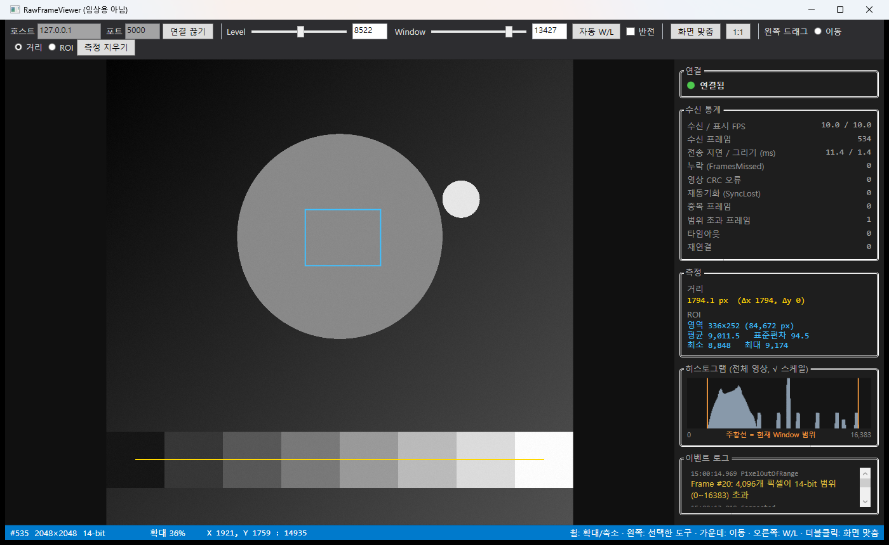

# RawFrameViewer

16-bit 검출기 영상을 TCP로 받아 표시하는 Windows 뷰어와, 실제 장비 대신 영상을 보내는 가상 검출기 시뮬레이터입니다.



> ⚠️ **임상용이 아닙니다.** 이 프로젝트는 영상 뷰어 엔지니어링, 장비 통신, 검증 과정을 보여주기 위한 개인 포트폴리오입니다. 진단이나 의료 목적으로 사용할 수 없습니다.

## 구성

| 프로젝트 | 설명 |
|---|---|
| `src/RawFrameViewer.Core` | 프레임 모델, 프로토콜 직렬화·파싱, CRC 검사, Window/Level 변환 |
| `src/RawFrameViewer.Simulator` | 가상 검출기. 16-bit 프레임을 생성해 TCP로 전송하고, 오류를 주입할 수 있음 |
| `src/RawFrameViewer.Viewer` | WPF(MVVM) 뷰어. 수신, 표시, W/L, 측정, 이상 프레임 감지 |
| `tests/RawFrameViewer.Core.Tests` | Core 단위 테스트 (xUnit) |

## 문서

- [프로토콜 명세](docs/protocol.md)
- [AI 활용 기록](docs/ai-log.md)
- 요구사항·테스트 추적표 (작성 예정)

## 개발 환경

- Windows 10/11
- .NET 10 SDK (`global.json`으로 고정)
- Visual Studio 2026 (.NET 데스크톱 개발 워크로드)

## 빌드와 실행

```powershell
dotnet build
dotnet test

# 1) 시뮬레이터 실행 (기본: 127.0.0.1:5000, 2048×2048, 14-bit, 10 fps)
dotnet run --project src/RawFrameViewer.Simulator -c Release -- --fps 10

# 2) 다른 터미널에서 뷰어 실행 (--connect: 바로 접속)
dotnet run --project src/RawFrameViewer.Viewer -c Release -- --connect
```

### 뷰어 조작

| 조작 | 동작 |
|---|---|
| 마우스 휠 | 커서 위치 기준 확대/축소 |
| 왼쪽 드래그 | 선택한 도구: 이동 / 거리 측정 / ROI 통계 |
| 가운데 드래그 | 이동 (도구와 관계없이) |
| 오른쪽 드래그 | Window/Level 조절 (가로: Window, 세로: Level) |
| 더블클릭 | 화면 맞춤 |
| 자동 W/L | 현재 영상의 최솟값~최댓값이 보이도록 설정 |

오른쪽 패널에는 연결 상태, 수신 통계(누락·CRC 오류·재동기화·타임아웃·재연결, 할당 속도·GC), 측정 결과, 히스토그램(현재 Window 범위 표시), 이벤트 로그가 있습니다.

### 오류 주입 (시뮬레이터)

명세 §7의 오류 F1~F6을 일부러 일으켜 뷰어가 감지·복구하는지 확인할 수 있습니다.

```powershell
# 일정으로 주입: FrameId 기준, 연결할 때마다 반복
dotnet run --project src/RawFrameViewer.Simulator -c Release -- --inject F1@15,F2@25,F3@35,F6@45,F4@55
```

실행 중 키보드로도 다음 프레임에 주입할 수 있습니다.

| 키 | 오류 | 뷰어 기대 동작 |
|---|---|---|
| 1 | F1 프레임 누락 | 누락 수 증가, 표시 계속 |
| 2 | F2 영상 데이터 손상 | 해당 프레임 폐기, CRC 오류 증가 |
| 3 | F3 헤더 손상 | 재동기화 후 정상 수신 |
| 4 | F4 연결 끊기 | 재연결 |
| 5 | F5 전송 정지 (4초) | 3초 후 타임아웃, 재연결 |
| 6 | F6 범위 초과 픽셀 | 경고 기록, 표시 계속 |
